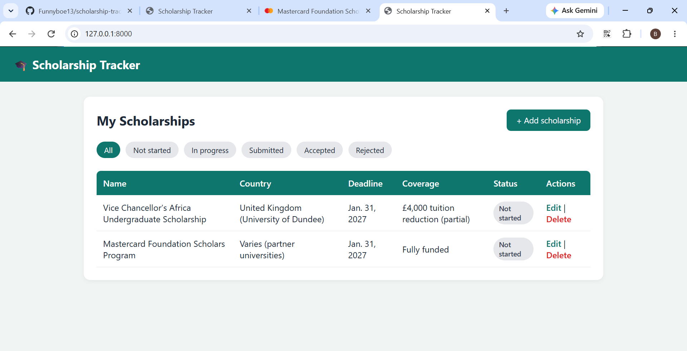

# Scholarship Tracker

A Django web app for keeping track of scholarship applications in one place, so no deadline gets missed.



## Features

- Add, edit, and delete scholarships
- Track name, country, deadline, coverage, link, status, and notes
- Status badges: Not started, In progress, Submitted, Accepted, Rejected
- Filter the list by status
- Highlights scholarships due within 7 days, and ones whose deadline has passed
- Admin panel for managing data

## Built with

- Python
- Django
- HTML and CSS

## How to run it

1. Clone the repository

```bash
   git clone https://github.com/Funnyboe13/scholarship-tracker.git
   cd scholarship-tracker
```

2. Create and activate a virtual environment

```bash
   python -m venv venv
   venv\Scripts\activate
```

3. Install the requirements

```bash
   pip install -r requirements.txt
```

4. Set up the database

```bash
   python manage.py migrate
   python manage.py createsuperuser
```

5. Start the server

```bash
   python manage.py runserver
```

6. Open http://127.0.0.1:8000 in your browser

## Future improvements

- User accounts, so each person has their own list
- Email reminders before deadlines
- Search by name or country

## Author

Made by Funnyboe13