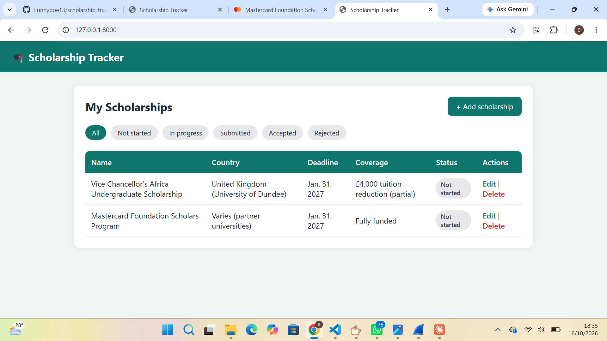

# Scholarship Tracker

A Django web app for keeping track of scholarship applications in one place, so no deadline gets missed. Each user creates an account and gets their own private list.



## Features

- User accounts: sign up, log in, and log out
- Every user sees only their own scholarships, and nobody can edit or delete someone else's
- Welcome popup after logging in or signing up, and confirmation popups when adding, editing, or deleting
- Add, edit, and delete scholarships
- Track name, country, deadline, coverage, link, status, and notes
- Status badges: Not started, In progress, Submitted, Accepted, Rejected
- Filter the list by status
- Rows are highlighted when a deadline is within 7 days or has already passed
- Admin panel for managing users and data

## Built with

- Python
- Django
- HTML and CSS

## How to run it

1. Clone the repository

```bash
   git clone https://github.com/Funnyboe13/scholarship-tracker.git
   cd scholarship-tracker
```

2. Create and activate a virtual environment

```bash
   python -m venv venv
   venv\Scripts\activate
```

3. Install the requirements

```bash
   pip install -r requirements.txt
```

4. Set up the database

```bash
   python manage.py migrate
   python manage.py createsuperuser
```

5. Start the server

```bash
   python manage.py runserver
```

6. Open http://127.0.0.1:8000, create an account with **Sign up**, and start adding scholarships

## Future improvements

- Email reminders before deadlines
- Search by name or country
- Live deployment

## Author

Made by Funnyboe13